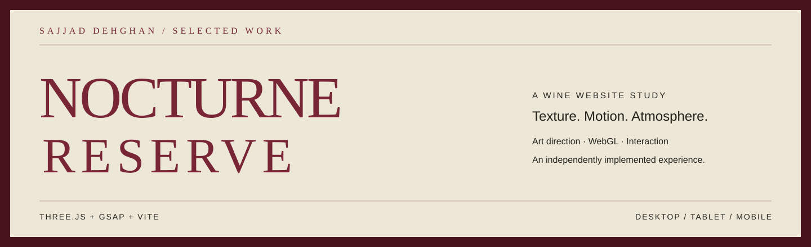
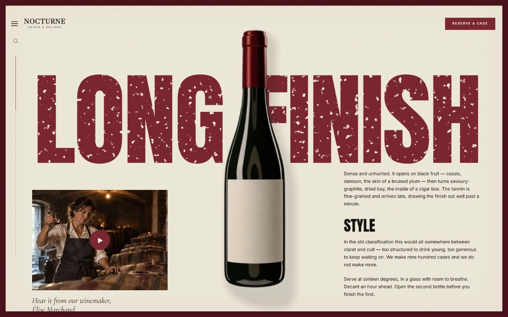
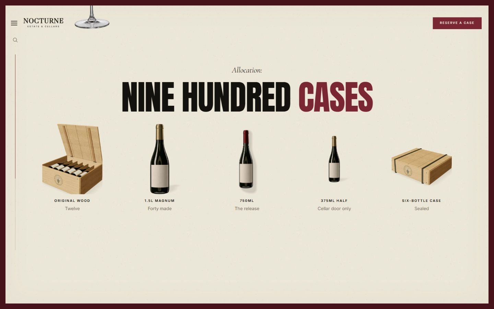
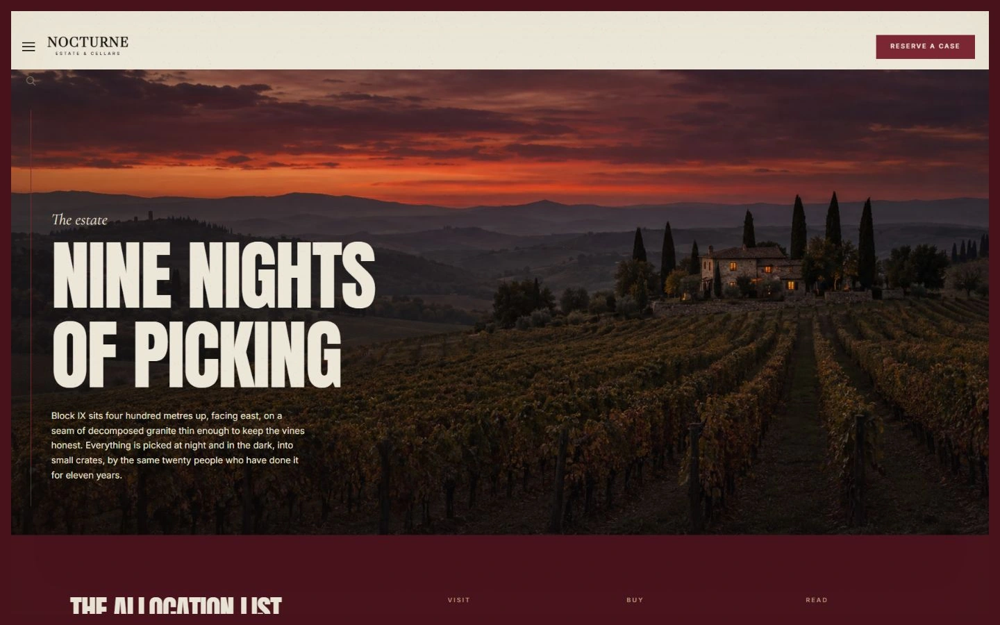
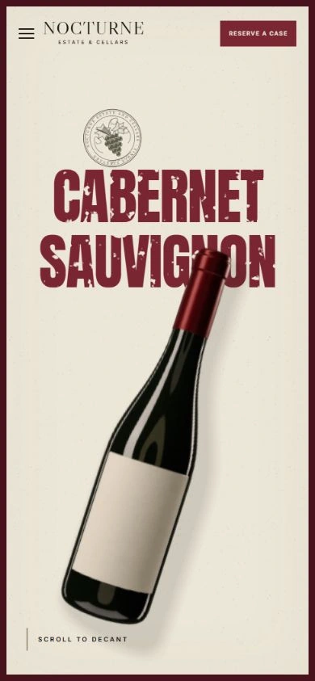
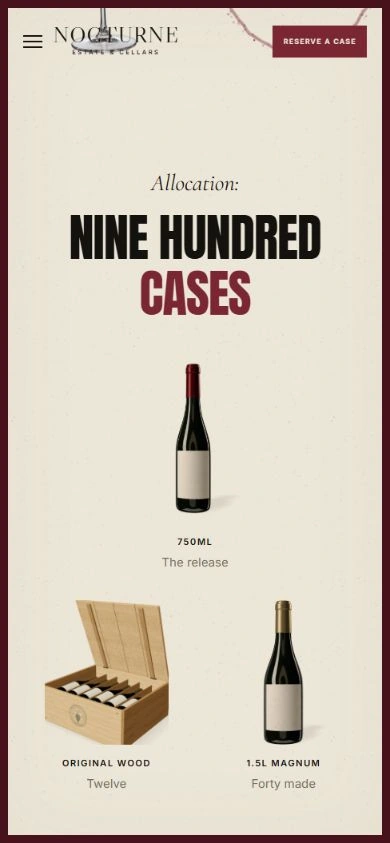

<p align="center">
  
</p>

<p align="center">
  <strong>A tactile wine story, built for the browser.</strong><br />
  Oversized worn typography, warm paper, editorial imagery and a bottle that follows the scroll.
</p>

<p align="center">
  <a href="#the-experience">Explore the work</a> ·
  <a href="#visual-tour">Visual tour</a> ·
  <a href="#run-locally">Run locally</a> ·
  <a href="docs/refinement-v3.md">Implementation notes</a>
</p>


## The experience

**Nocturne Reserve** is an independently implemented luxury wine website study by [Sajjad Dehghan](https://github.com/sajjad-dehghan). It explores how typography, material texture and product motion can turn a single-page website into an editorial experience.

The visual reference is [Vesper by Scrolltide](https://www.scrolltide.co/templates/vesper). This repository contains the implementation, generated visual assets, procedural model source and refinement notes. It is an independent study with attribution, unaffiliated with Scrolltide.

| Design | Motion | Build |
| :--- | :--- | :--- |
| Oxblood ink, aged paper and oversized type | A persistent bottle rotates, settles and docks into the catalog | Vanilla JavaScript, Vite, Three.js and GSAP |
| Editorial cellar, dining and vineyard scenes | Chapter navigation and scroll-linked details | Local fonts, WebP images and GLB models |

## Visual tour

### The character

The bottle becomes the visual axis between the winemaker's portrait and the tasting narrative.



### The allocation

Five product formats share one visual system: an open wooden case, a magnum, the standard release, a half bottle and a sealed case. Selecting a format opens its corresponding reservation dialog.



### The estate

An evening vineyard scene closes the story with a change in scale, color and atmosphere.



### On a smaller screen

The layout adapts its typography, bottle placement and product grid for mobile.

<p align="center">
  
  &nbsp;&nbsp;
  
</p>

<sub>All screenshots show the implemented site. Desktop: 1440 × 900. Mobile: 390 × 843.</sub>

## What is implemented

- **Scroll-driven product rendering:** a WebGL bottle moves from the hero through the story into the allocation section.
- **Custom visual assets:** generated bottle imagery and editorial scenes, transparent product cutouts, paper texture, ink wear, seals and wine marks.
- **Six editable 3D assets:** standard bottle, magnum, half bottle, wine glass, open wooden case and sealed wooden case, exported as GLB.
- **Working interactions:** chapter navigation, chapter search, winemaker and pairing dialogs, product format selection, reservation and allocation-list forms.
- **Responsive foundations:** mobile and tablet layouts, semantic markup, native dialogs, focus handling, reduced-motion rules and a static WebGL fallback.

## How the bottle is built

The visible bottle uses **hybrid rendering**: a generated transparent photographic plate is mapped to a Three.js plane for detailed glass and foil reflections. A measured procedural bottle mesh supplies the shadow and remains available as an editable GLB. Scroll position controls the shared product transform.

This choice preserves a consistent photographic appearance in the intended front-facing compositions. Reflections are baked into the image; the visible bottle is not a fully volumetric product viewer. Catalog bottles use transparent renders, while the wooden cases are built from procedural geometry and materials.

| Layer | Source |
| :--- | :--- |
| Page interactions and scroll choreography | [`src/main.js`](src/main.js) |
| Photographic product plate | [`src/bottle-photo.js`](src/bottle-photo.js) |
| Editable bottle, glass and case geometry | [`src/models.js`](src/models.js) |
| Studio lighting and catalog rendering | [`src/studio.js`](src/studio.js), [`src/catalog.js`](src/catalog.js) |
| Layout, type and responsive rules | [`src/style.css`](src/style.css) |

## Run locally

Use Node.js **20.19+ or 22.12+**.

```bash
git clone https://github.com/sajjad-dehghan/nocturne-reserve.git
cd nocturne-reserve
npm ci
npm run dev
```

Open **http://127.0.0.1:4178**.

```bash
npm run build     # Production files in dist/
npm run preview   # Serve the production build locally
npm run check     # Asset, anchor, product and GLB checks
npm run models    # Regenerate the six GLB models
```

To render catalog assets in development, open `http://127.0.0.1:4178/?render-products=1`. The model and texture generation scripts are included in [`scripts/`](scripts/).

## Project map

```text
src/                 Application, styling, WebGL and interaction code
public/assets/       Website-ready images and SVG textures
public/models/       Six exported GLB models
public/fonts/        Local fonts and their licenses
design/assets/       Preserved original images and product renders
design/references/   Visual comparison references
scripts/             Asset generation, model export and validation
docs/                Asset provenance, refinement notes and screenshots
```

## Validation & scope

The production build and structural checks pass. Checks cover local asset references, section anchors, five catalog entries, six GLB files, bottle-label clearance and the twelve-bottle case. Browser checks, exercised interactions and remaining unverified cases are recorded in [`docs/validation.md`](docs/validation.md).

This is a frontend portfolio study. Product details and characters are illustrative. Reservations and sign-ups are saved in the browser's local storage; they do not send email, take payment or create orders. The winemaker button opens a photographic story dialog. Exact pixel identity with the original template and measured Lighthouse scores are not claimed.

Generated image prompts and asset provenance are documented in [`docs/asset-prompts.md`](docs/asset-prompts.md). Font licenses are included in [`public/fonts/licenses/`](public/fonts/licenses/).

---

<p align="center">
  <strong>Nocturne Reserve</strong><br />
  A study in visual storytelling and browser craft.<br />
  <a href="https://github.com/sajjad-dehghan">Sajjad Dehghan</a>
</p>

